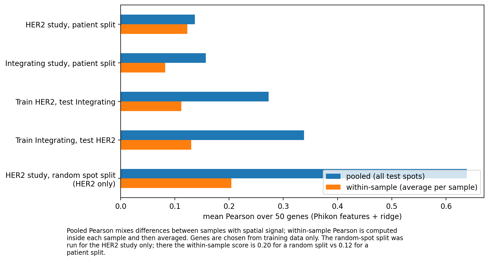
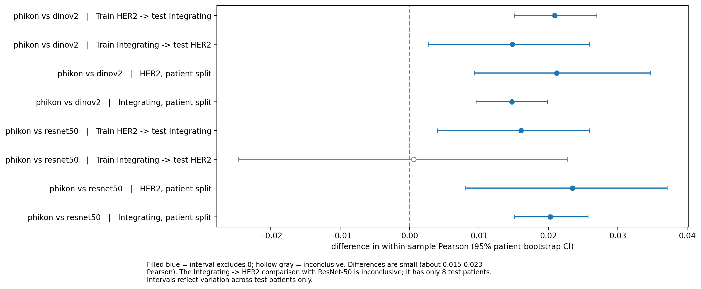
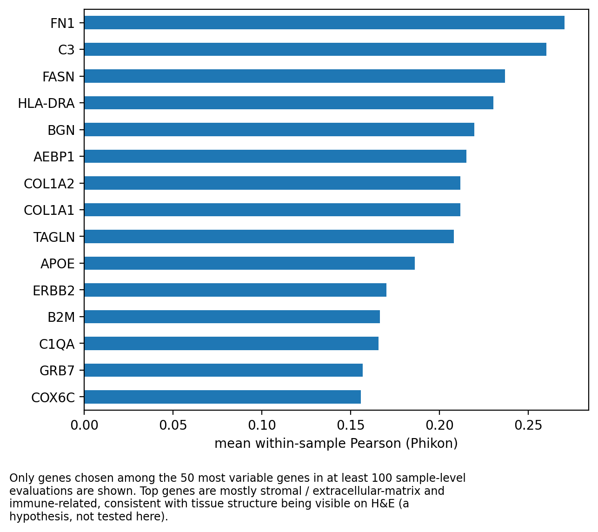
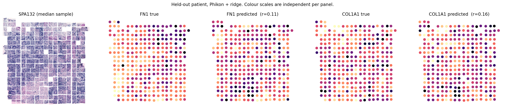
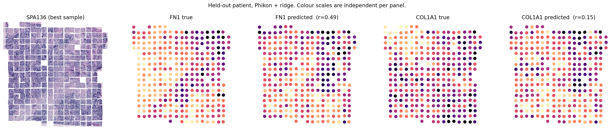

# Histology-to-Expression Probe

Predicting spatial gene expression from H&E image patches using **frozen foundation-model features**, evaluated on **held-out patients** (HEST-1k, human breast cancer).

## Research question

How well do frozen image features from (a) an ImageNet CNN, (b) a general self-supervised ViT and (c) a pathology-specific ViT predict spatial gene expression, and how much do evaluation choices (random spot split vs patient split, pooled vs within-sample scoring) change the answer?

## Summary of findings

1. **Evaluation choices change the picture more than the model does.** Pooling all test spots before computing Pearson mixes differences *between* samples with spatial signal *within* a tissue. For the cross-study tests, pooled Pearson was 0.24-0.34, but within-sample Pearson was only 0.09-0.13, about the level of the patient-split scores.
2. **Random spot splits leak information.** In the HER2 study, Phikon features scored 0.204 (within-sample Pearson) with a random spot split vs 0.123 with a patient split, about 1.7x higher. Pooled scores differed far more (0.638 vs 0.137), but most of that gap is between-sample information. The within-sample random split was run for the HER2 study only.
3. **Phikon (pathology-specific) is consistently, but only slightly, better.** Phikon beat DINOv2 in all four patient-level settings and beat ResNet-50 in three of four (95% patient-bootstrap intervals above 0). Gaps are small: about 0.015-0.023 Pearson. DINOv2 and ResNet-50 were essentially tied.
4. **Absolute performance is modest.** With Phikon, within-sample Pearson on held-out patients was 0.08-0.13 (mean over 50 genes). This is a weak-to-moderate signal, not a diagnostic tool.
5. **The most predictable genes are tied to visible tissue structure.** The top genes were mostly stromal / extracellular-matrix (FN1, BGN, AEBP1, COL1A1, COL1A2, TAGLN) and immune-related (HLA-DRA, C3). This is consistent with such structure being visible on H&E, but I did not test that explanation directly.
6. A **shuffled-feature control** scored about 0 (pooled Pearson between -0.002 and 0.001 in every setting), so the evaluation pipeline is not producing signal by itself.

## Data

- **HEST-1k** (Jaume et al., NeurIPS 2024; arXiv 2406.16192): paired H&E images and spatial transcriptomics. Gated on Hugging Face (`MahmoodLab/hest`), license CC BY-NC-SA 4.0. **I do not redistribute any HEST data.**
- Subset used: human **breast**, older **Spatial Transcriptomics** technology, samples with a patient ID: **104 samples, 31 patients, two source studies**.

| Study | Samples | Patients | Spots |
|---|---|---|---|
| HER2-positive breast cancer study | 36 | 8 | 13,611 |
| "Integrating spatial gene expression and breast cancer..." study | 68 | 23 | 30,600 |

- 44,211 spots after matching expression rows to image patches by barcode (63 spots had no patch, 1 had zero counts).
- 10,155 genes shared by both studies. One study used Ensembl IDs and the other used gene symbols; Ensembl IDs were mapped to symbols with `mygene` (11,365 of 11,787 mapped).
- Expression: counts normalized to 10,000 per spot, then log1p.

## Method

- **Features:** 224x224 patch around each spot, frozen encoders, float16 embeddings: ResNet-50 (ImageNet), DINOv2-base, Phikon (`owkin/phikon`, CLS token).
- **Targets:** the 50 most variable genes among genes expressed in at least 10% of *training* spots. Selected inside each training set only.
- **Model:** standardized features and ridge regression (strength chosen from 1e2-1e5 by built-in leave-one-out).
- **Splits:**
  - *Patient-level* 5-fold GroupKFold within each study. The group key is `study | patient` (patient names repeat across studies); all sections of a patient stay on one side.
  - *Random spot* 5-fold (leakage comparison).
  - *Cross-study*: train on one study, test on the other, both directions.
- **Metrics:** mean Pearson over the 50 genes, computed two ways: *pooled* over all test spots, and *within-sample* (per gene inside each test sample, then averaged over genes and samples).
- **Uncertainty:** 95% bootstrap intervals over test patients for model differences.

## Results

### Mean Pearson over 50 genes (Phikon / DINOv2 / ResNet-50)

| Setting | Within-sample | Pooled |
|---|---|---|
| HER2 study, patient split | 0.123 / 0.104 / 0.101 | 0.137 / 0.122 / 0.115 |
| Integrating study, patient split | 0.082 / 0.068 / 0.062 | 0.157 / 0.124 / 0.114 |
| Train HER2, test Integrating | 0.112 / 0.091 / 0.096 | 0.273 / 0.240 / 0.219 |
| Train Integrating, test HER2 | 0.130 / 0.119 / 0.125 | 0.338 / 0.297 / 0.296 |
| HER2 study, random spot split | 0.204 / 0.158 / 0.151 | 0.638 / 0.571 / 0.547 |
| Integrating study, random spot split | not run | 0.592 / 0.485 / 0.469 |

### Figures







**Spatial examples (held-out patient, trained on the other HER2-study patients).** Samples were chosen by their FN1 score, so the "best" panel is selected on the outcome and is not typical. Spot colours are independent per panel (light = high expression); the image on the left is a mosaic of the 224-pixel spot patches, not the whole slide.





- Median sample (SPA132): FN1 r = 0.11, COL1A1 r = 0.16.
- Best sample for FN1 (SPA136): FN1 r = 0.49, COL1A1 r = 0.15.

## Limitations

- Only two source studies; the HER2 study has just 8 patients, so intervals there are wide.
- Spots come from an older, low-resolution technology (each spot covers many cells).
- Only 50 genes per training set, a linear probe and three frozen encoders. No fine-tuning.
- Ridge strength is chosen by leave-one-out over spots; neighbouring spots are similar, so this may favour weak regularization.
- Bootstrap intervals reflect variation across test patients only, and no correction for multiple comparisons was applied.
- Pathology foundation models are often pretrained on public repositories (e.g., TCGA) that also feed public benchmarks; I did not check the pretraining data of any model against these samples, so scores may be optimistic.
- The within-sample random-split comparison was run for the HER2 study only, and the shuffled control was computed on the pooled metric.
- Ridge predictions are shrunk toward the mean, so predicted maps look smoother than the truth.

## Next steps

- Add more pathology encoders (e.g., UNI, if access is approved).
- Predict more genes and try a non-linear head or light fine-tuning, with patient-level validation.
- Repeat with other organs in HEST-1k.

## Repository structure

```
histology-to-expression-probe/
├── README.md
├── .gitignore                       # excludes data/, *.h5, *.h5ad, *.npy, *.npz
├── histology_to_expression_probe.ipynb   # the full pipeline, run top to bottom (see sections below)
├── metadata/
│   ├── spots.csv                    # one row per spot: sample id, barcode, study, patient, group key
│   ├── final_genes.csv              # the 10,155 genes shared by both studies
│   └── ens2sym.csv                  # Ensembl ID -> gene symbol mapping
├── results/
│   ├── results_v1.csv               # pooled Pearson, all settings, includes shuffled-feature control
│   ├── results_v2_within.csv        # pooled and within-sample Pearson per fold
│   ├── per_gene_within_sample.csv   # within-sample Pearson per gene, sample and model
│   └── bootstrap_ci.csv             # patient-level bootstrap intervals for model differences
└── figures/
    ├── fig1_pooled_vs_within.png
    ├── fig2_model_differences.png
    ├── fig3_top_genes.png
    ├── fig4_spatial_median.png
    ├── fig4_spatial_best.png
    └── captions.md
```

Not stored in the repo (too large, or covered by the HEST license): the HEST expression and image files, the normalized expression matrix (`X_logcp10k.npz`) and the feature embeddings (`feat_*.npy`). They are regenerated by the first sections of the notebook.

### Notebook sections

1. **Setup and data access:** Hugging Face login, HEST metadata, sample selection.
2. **Download and alignment:** download (about 13 GB to Colab's local disk, not Google Drive), barcode matching, gene-name mapping, normalization.
3. **Feature extraction:** frozen ResNet-50, DINOv2 and Phikon features (float16), about 6 minutes on a T4.
4. **Probe experiments:** ridge probes, patient / random / cross-study splits, pooled vs within-sample Pearson, per-gene results and bootstrap intervals, about 20 minutes.
5. **Figures:** figures 1-4 and captions.

## Reproducing

1. Create a Hugging Face account, accept the `MahmoodLab/hest` terms and create a token.
2. Open `histology_to_expression_probe.ipynb` in Colab, switch the runtime to a T4 GPU and run it from top to bottom.
3. The expression matrix and embeddings are intermediate files and are not in this repo. If you want to avoid recomputing them, store them in your own private storage.

## Licenses and credits

- HEST-1k: CC BY-NC-SA 4.0 (non-commercial); see the dataset card. Check each model's license before reuse (Phikon: `owkin/phikon`; DINOv2: `facebook/dinov2-base`; ResNet-50: torchvision).
- Tools: PyTorch, Hugging Face Transformers, scikit-learn, Scanpy, h5py, mygene.
- Jaume et al., *HEST-1k: A Dataset for Spatial Transcriptomics and Histology Image Analysis*, NeurIPS 2024.

*Research portfolio project. Not for clinical use.*
